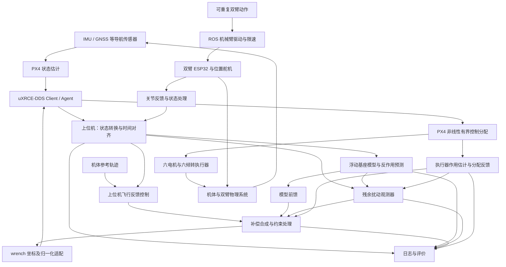

# 抗扰控制算法设计：软件架构

整理日期：2026年10月18日；2026年11月3日补充实现状态。

> 2026年11月3日：飞行基座六维净残差动量型 NDOB 已接入 `px4_wrench` 代码链路，默认关闭，支持影子运行和独立补偿开关。数学、输入、日志和未验证边界见 [NDOB 说明](docs/ndob.md)。下文中“未实现”等表述保留为原设计时点记录，最新完成状态以[当前进度](当前进度.md)为准。

本文描述拟实现的研究架构，不表示各模块已交付。首阶段由上位机承担无人机飞行反馈控制、动力学补偿与残余扰动补偿；PX4 保留状态估计、控制分配、执行及失联处置。双臂沿用现有位置伺服，不新增关节抗扰控制器。

## 1. 运行分工与数据流

上图中的 Client 位于飞控，Agent 位于上位机。DDS 桥承担双向消息传输，不保证固定时延或硬实时性。飞控链路首选有线串口或以太网；热点作为地面监控路径。双臂 ESP32 首选有线串口与当前协议，不能因飞控使用 uXRCE-DDS 就假定 ESP32 已具备 micro-ROS 接口。

实验保留两种互斥飞行模式：

- **原生基线**：ROS 发位置轨迹，PX4 运行原生位置/速度、姿态/角速度控制及分配。
- **研究模式**：上位机完成飞行反馈控制，向 PX4 发送推力与力矩目标，使用 PX4 状态估计和分配。对应 Offboard 层级绕过原生飞行控制环，不能把它理解为给原环路自动叠加补偿。

模式切换必须有明确所有权、目标对齐和状态初始化；不得同时存在竞争的控制发布者。原生模式保留用于对照，不意味着研究模式故障时可以不经验证就无缝切换。

## 2. 动力学模型与分解边界

### 2.1 浮动基座模型

广义速度由基座六维运动与十个机械臂关节速度组成。用下式表达耦合结构：

\[
M(q)\dot{\nu}+h(q,\nu)
=S_b^\mathsf{T}W_{\mathrm{prop}}+S_a^\mathsf{T}\tau_a+Q_{\mathrm{ext}}.
\]

其中，`q` 包含基座构型和关节位置，`ν` 为相容的广义速度，`h` 含重力与科氏/离心等项，`S_b`、`S_a` 表示基座与关节输入映射。正式推导时必须固定速度表示、坐标及 wrench 参考点，不能直接把不同表示的量混合。

基座与机械臂不能独立当作固定底座系统处理。模型需要机体姿态、速度和必要的加速度信息，以及双臂实际 `q_a`、`dq_a` 和 `ddq_a` 估计。关节加速度不可从带噪位置直接无滤波二次差分；估计算法、延迟与有效性必须记录。预测可使用平滑目标轨迹，但必须与实际关节反馈区分。

三组双轴倾转机构及旋翼的作用由执行器/分配模型描述。若简化其运动惯性，应把简化边界及残余效应写清楚；不宣称“十关节模型”已经包含全部运动构件的精确动力学。

### 2.2 机械臂对底座的 wrench

诊断接口定义 `W_arm_to_base`：机械臂施加于基座的力和力矩，顺序为 `[Fx,Fy,Fz,Tx,Ty,Tz]`，单位 N、N·m，表达在 FLU 机体系，力矩关于 `uav_base_link` 原点。左右臂各自计算后，先转换到这一共同表达再相加。

模型分解必须在算法实现前明确并通过检验：

- 在“裸机体 + 安装界面反作用”分解中，裸机体惯性不含已作为子系统计算的机械臂；双臂重量、惯性与运动作用经界面传递。
- 在完整整机耦合方程中，机械臂质量和耦合已经进入质量矩阵及偏置项，不能再把完整界面反作用作为额外整机外力加入。
- 当前 PX4 适配具有固定整机标称质量、质心和惯量。接入时须对照其实际计算路径，推导研究控制量与名义尺度之间的映射；不能在整机重力补偿之上再无条件添加完整机械臂重量。

工程以完整耦合模型作为一致性参考，保留界面反作用作为诊断输出。最终实现可使用等价简化模型，但须说明与名义控制模型相比补偿的是哪些差量，不能以经验常数掩盖重复计算。

固定臂静态平衡、单关节运动、无外力动量一致性及时间步长收敛是模型检查内容。Gazebo 多刚体模型已产生的机械臂反作用不再注入一次人工 wrench。

## 3. 状态估计、误差与扰动观测

三者职责不同：

| 模块 | 输入与输出 | 不应混淆的边界 |
|---|---|---|
| 导航状态估计 | IMU、GNSS 等融合为姿态、速度、位置及有效性 | IMU 测比力和角速度，不直接给绝对位置 |
| 跟踪误差 | 参考轨迹与估计状态形成位置、速度和姿态误差 | 误差可能来自指令变化、时延、饱和或模型误差 |
| 扰动观测 | 已声明模型、测量状态与执行器作用估计形成残余 wrench | 不是直接把位置误差乘常数后称为外扰 |

首个研究方案采用模型辅助扰动观测路线。具体采用动量观测、其他 DOB 或 ESO，应在模型和反馈条件确认后选择并记录依据；本阶段不声称算法形式、增益和带宽已定型。

观测器的输出定义为相对于名义模型的合成残余力/力矩；其中可能包含气动扰动、参数误差、未建模执行器响应和部分测量误差。它不能仅凭机体运动可靠区分每个来源，也不能识别所有内部关节扰动。

观测器应使用与实际施加作用尽量一致的输入。区分请求 wrench、分配后可实现 wrench、执行器模型预测 wrench 和真实物理作用；限幅后输出重建不等于已经测量真实推力。没有直接测量时，明确执行器估计及其不确定性，避免把所有执行器滞后误判为风扰。

组合方案中，观测器应考虑完整已施加输入，包括前馈和已有观测补偿。观察残差的模型必须与实际补偿分解一致，防止重复抵消相同耦合。

如果定义残余扰动为动力学右端正向作用，补偿在相同坐标和参考点下采用相反作用方向；符号以已知力/力矩注入实验核验。姿态误差采用旋转群或等价一致表示，不直接对欧拉角作无约束相减。

## 4. 模块与逻辑接口

以下飞行算法接口仍为设计契约；硬件遥测已创建 dragonfly_interfaces 与 dragonfly_serial，具体消息见 [遥测协议](docs/telemetry-protocol.md)。继续复用匹配版本的 px4_msgs；不将已有遥测接口等同于已实现飞行研究控制器。

| 模块 | 主要输入 | 主要输出及约束 |
|---|---|---|
| 状态适配与对齐 | PX4 导航、角速度、IMU、状态重置信息 | 统一坐标、参考点、采样时刻和有效性，保留原始来源 |
| 双臂驱动 | 轨迹、ESP32 响应 | 两臂各五关节的目标与实际状态，标记过期与错误；夹爪单独处理 |
| 模型服务 | 参数、基座及关节状态 | 耦合预测、左右臂界面 wrench、名义模型相关量和质量标记 |
| 前馈 | 模型预测 | 有限幅和启停状态的补偿，注明物理意义与符号 |
| 扰动观测器 | 模型、状态、执行器作用估计 | 残余 wrench、初始化/复位/有效状态 |
| 飞行控制器 | 轨迹与状态误差 | 名义物理 wrench，负责反馈控制及其积分状态 |
| 补偿合成与约束 | 名义 wrench、前馈、残余补偿、分配反馈 | 合成请求、限制信息；避免不可实现指令持续累积 |
| PX4 适配 | 合成物理 wrench、模式状态 | FRD 归一化推力/力矩消息、Offboard 模式与心跳 |
| 执行器作用估计 | 分配输出、执行器状态、响应模型 | 可实现/预测作用及分配残差，明确是否为测量 |
| 日志与评价 | 上述数据和实验配置 | 可复核时间序列、事件、指标、参数及版本快照 |

### 4.1 坐标、参考点和量纲

- 内部采用世界 ENU、机体 FLU，单位 m、s、rad、N、N·m；对接 PX4 时使用其 NED/FRD 语义。
- 位置评价点统一为 `uav_base_link` 原点。导航位置如果参考 IMU 或其他点，应处理安装杆臂；IMU 比力用于动力学时还需处理重力、安装姿态及转动产生的杆臂加速度。
- 同一作用从参考点 A 换到 O，若 `r_OA` 为 O 指向 A 的向量，且各量已在同一坐标系表达，则 `τ_O = τ_A + r_OA × F`。旋转坐标时同时旋转力和力矩，不能只旋转力。
- ROS wrench 类型仅凭 `frame_id` 不一定足以说明任意力矩参考点，因此接口约定必须固定其原点；必要时通过附加元数据明确。
- `VehicleThrustSetpoint.xyz` 和 `VehicleTorqueSetpoint.xyz` 是 FRD 下的归一化量，不能直接写入 N 或 N·m。
- 原 Dragonfly 分配适配使用质量、加速度尺度、完整标称惯量、角加速度尺度和质心偏移换算。实现前须按当前源码逐项核对，并验证物理量到归一化量再回到物理量的往返一致性。归一化适配中的名义参数不应被误当成新的外扰补偿。

### 4.2 时间与反馈质量

保留采样时刻和接收时刻，声明墙钟、仿真时钟和 PX4 时钟的对应关系。融合状态、关节状态与执行器作用必须在可接受的时差内配对；不能简单将“最后收到的一条”视为同一时刻。

ROS 2 QoS、DDS 话题映射、消息版本、发布/订阅频率和 Agent 版本需与实际 PX4 构建一起验证。Offboard 存活心跳门槛不是控制周期或可用带宽的证明。具体运行频率和数据有效期依据测量确定。

ESP32 当前的负载值、电流值、速度值须检查单位、符号、标定和真实上报路径。每个关节数据都应有可判断的新鲜度；肩部双舵机反馈不能未经同步直接作可靠差值。位置执行接口与仿真 effort 接口采用独立执行器模型，不声称两者等价。

### 4.3 已实现的硬件采集架构

`ESP32 周期采集 → 有界发送队列 → 双路独立串口线程 → 分帧/协议验证 → 分臂质量检查 → ROS 类型化消息 / JSONL`。离线回放进入同一解析和质量检查入口，不创建串口工作线程。T606 配置服务仅接受显式请求，无机械臂动作发送接口；上图中的轨迹驱动仍是未来功能，不在此次硬件采集中启用。

每个 ESP32 采用七舵机独立快照，事务锁保护总线，运动等待和回放不持有整段锁。ESP-NOW 回调只入队，主上下文验证并执行，不在回调争用全局 JSON。采集任务与发送任务分离，发送积压保留最新完整遥测；绝对读取截止时间和整轮预算用于防止单舵机超时占满周期，实机调度抖动尚待测量。

主机左右臂各自保存身份、启动标识、序号、最后接收时刻与错误计数；不复用仿真 arms.py 的单个 state_time。肩部力矩合成同时要求两来源有效，保留各自读取完成时刻；并非同步 ADC 采样。原始电流、速度和负载保留，线性电流力矩粗估单独发布并标记未标定；它不替代浮动基座动力学求解。

硬件话题统一在 `/hardware`，可选 FK 输出也置于该命名空间；仿真与采集不自动互联。字段、质量标志、模式切换、波特率和时间语义详见 [协议](docs/telemetry-protocol.md)。

## 5. 约束、初始化和异常处理

控制设计必须考虑电机推力、倾转角度、倾转速率、机械臂轨迹约束及控制分配残差。“全驱动”只描述一定工作条件下的能力，不代表任意 wrench 都可瞬时实现。

前馈和观测补偿需可独立启停、限制幅值并记录切换。启用前检查状态有效性和观测器初始化；导航重置、时间跳变、参数切换及模式变化必须触发明确的状态处理。滤波、限幅和积分抗饱和要考虑附加相位滞后，不能通过无限提高观测器增益解决噪声和时延。

状态失效或链路中断后，禁止无限期沿用旧目标。实机应定义进入失效状态的条件、由谁接管以及接管后的飞行模式；具体阈值和动作须在硬件与定位能力确认后通过台架/仿真验证，再允许实飞。文档不默认自动返航、降落或停桨适用于该平台。

机械臂停止与无人机飞行失效是不同事件，须分开处理。不能直接复制原 SITL 的“终止仿真”或 Offboard 丢失终止配置作为实机方案。

## 6. 验证与记录

验证顺序为模型一致性、原生基线、上位机无补偿、前馈、观测器、组合方案及硬件联调。实验模式、动作、扰动、模型参数、随机种子、软件版本与时间基准必须可追溯。

最小验证集包括：

1. 静态重力、左右臂安装变换、反作用符号与参考点变换；固定臂时无重复重量补偿。
2. 物理 wrench 与 PX4 归一化控制量往返检查；模式互斥和状态初始化检查。
3. 无外扰、已知外加力/力矩、单臂/双臂动作及参数偏差下的预测与估计比较。
4. 噪声、偏置、反馈过期、时延、丢包、饱和及分配不足下的响应和异常行为。
5. 保留旋翼与多刚体物理模型，不用理想 wrench 成绩替代最终物理链路成绩；检查时间步长敏感性。

日志至少包含参考与实际机体状态、关节目标与实际状态、模型预测、残余估计、名义控制量、各补偿项、合成请求、分配输出与残差、状态有效性和模式事件。仿真真值作为独立评价通道；若研究阶段使用真值辅助调试，明确标记，不能与估计反馈模式混合报告。

具体性能指标及历史回归阈值见 [产品需求](产品需求.md)。没有实际执行的检查不得在 [当前进度](当前进度.md) 标为通过。

## 7. 依据与适用边界

本地依据为 Dragonfly 三份基础文档、`/home/ubuntu/Dragonfly/src/dragonfly_flight/config/px4_vector/README.md`、当前 PX4 `dds_topics.yaml` 与本机 RoArm-M3 固件。旧工程参数、模式和实物能力之间存在差异，以当前源码与实际验证结果为准。

- [PX4 v1.16 uXRCE-DDS：Client/Agent、传输与消息配置](https://docs.px4.io/v1.16/en/middleware/uxrce_dds)
- [PX4 v1.16 Offboard：控制层级与归一化推力/力矩接口](https://docs.px4.io/v1.16/en/flight_modes/offboard)
- [RoArm-M3 指令说明：位置控制、反馈与力矩限制](https://www.waveshare.com/wiki/RoArm-M3-S_JSON_Command_Meaning)
- [VectorNav 惯性导航原理](https://www.vectornav.com/resources/inertial-navigation-primer)
- [空中机械臂变惯量建模研究](https://arxiv.org/abs/2401.04316)：提供相关建模思路，不是本平台性能证明或已选定算法。

本仓库已交付继承仿真代码和硬件遥测消息/接收适配，飞行研究控制器、动力学前馈、观测器及硬件联调仍未实现。技术资料支持接口事实和研究方向，不能替代本平台的实现与实验。
