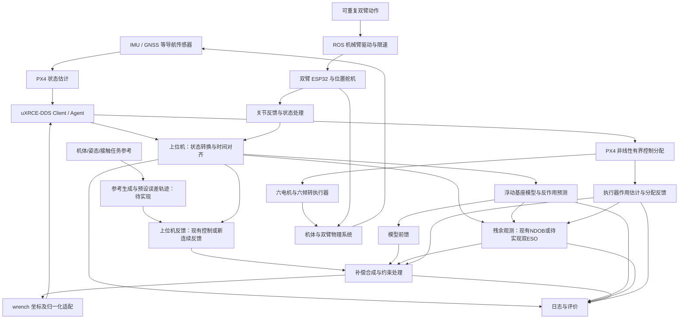

# 抗扰控制算法设计：软件架构

更新日期：2026年11月5日。

第一步最新验收：原生 3/3 通过，研究无补偿 0/3 通过；接口实现完成，整体基线验收未通过。详见[第一步基线复现结果](docs/step1-results.md)。

当前已经实现共享耦合动力学、模型差量前馈、六维动量型 NDOB、物理 wrench 飞控桥及 SITL 研究控制链。`flight.yaml` 当前为 `enabled=true`、`shadow_mode=true`、`compensation_enabled=false`，即 NDOB 仅观测不补偿；历史文档中的“默认关闭”不是当前配置快照。已有单轮固定臂悬停记录，但 NDOB 连续性未通过、闭环抗扰收益未验证。数学和历史记录见[NDOB说明](docs/ndob.md)，当前能力以[当前进度](当前进度.md)为准。

新增的双 ESO、预设误差轨迹、执行能力协调及无力传感接触模块均为设计，尚未实现。研究主线沿用上位机反馈控制与共享算法包，PX4 保留状态估计、控制分配、执行及失联处置；原生 PX4 反馈作为互斥对照。本次没有把控制器迁入 PX4。双臂沿用位置伺服，不新增关节抗扰控制器；仿真 effort 接口与实机位置接口保持独立建模。

## 0. 源码与部署边界（2026年11月5日）

本轮唯一实施工程为 `E:/subjects/Disturbance Rejection Control Algorithm Design`，WSL 直接使用对应 `/mnt/e/subjects/Disturbance Rejection Control Algorithm Design`；与 `/home/ubuntu` 下同名检出不是同一工作区。每轮启动保存源码与外部 PX4 的提交、差异、文件哈希及实际构建来源，不能仅凭工程名称认定代码一致。

第一步已增加共同接口契约、运行配置入口、控制所有权检查及六轮基线批处理，详细定义见[控制接口与基线契约](docs/control-contract.md)。`BodyWrenchCommand` 字段保持兼容，桥、PX4 参数生成和运行日志共用 `WrenchScale`；分配残差按请求减实现处理，并补齐回到机体原点的交叉力矩。运行时与离线验收共用模式规则，四个原生反馈环在研究模式必须全部关闭。

`flight --config` 接受独立完整 YAML，省略时仍使用包内默认配置。`scripts/run_baselines.sh` 按原生/研究交替执行三轮 acceptance，并保存每轮失败。物理插件从 `dragonfly_sim/lib` 加载；PX4 使用独立无空格临时工作目录，结束后归档回实验目录，解决 E 盘工程路径含空格的启动问题。上述是接口与运行支持的实现状态，不代表六轮飞行验收已经通过；结果见[当前进度](当前进度.md)。

仓库现按 ROS 包依赖分为三层：`dragonfly_control`、`dragonfly_arm` 和 `dragonfly_interfaces` 是仿真与实机共同来源；`dragonfly_serial`、`dragonfly_fcu_bridge`、`dragonfly_onboard` 构成当前机载构建；`dragonfly_sim` 和 `dragonfly_flight` 只进入 WSL 仿真构建。

`dragonfly_control` 保存唯一的耦合动力学、前馈和 NDOB 实现。`dragonfly_sim` 保存 Gazebo 世界、插件与固定机演示。`dragonfly_arm` 保存共同几何、惯性参数、URDF 和运动学，不再承担 Gazebo 启动。机载使用 `build-onboard/install-onboard`，仿真使用 `build-sim/install-sim`，详细命令及当前限制见[仿真与机载部署](docs/deployment-layout.md)。

当前 `dragonfly_flight` 的运行时仍显式使用仿真时钟、Gazebo 真值和仿真执行器反馈，因此没有被纳入机载构建。后续机载飞行控制节点应复用 `dragonfly_control`，并另行实现 PX4 状态对齐、真实关节反馈、执行器作用估计和失效处置，不能把 SITL 运行时原样部署到机载电脑。

新增 ESO、预设轨迹和连续反馈的纯计算实现计划放入 `dragonfly_control`，仿真与机载运行时调用同一来源，不分别复制。机载入口 `dragonfly_onboard` 当前默认只启动双臂遥测，`start_fcu_bridge=false`；机载可构建不代表机载飞行闭环可运行。参数和外部 PX4 路径继续由现有配置与 `scripts/env.sh` 管理。

### 0.1 两套 PX4 参考代码

桌面参考目录：`C:/Users/LENOVO/Desktop/为测试倾转涵道HTE保存三元矢量原版代码`。WSL 外部编译树默认：`/home/ubuntu/PX4-Autopilot`，由实际 `PX4_ROOT` 和版本快照确认。本仓库的 `src/dragonfly_flight/config/px4_vector` 是源码来源/适配记录，不是已烧录固件证明。

| 项目 | 桌面三元矢量五文件 | 当前 WSL 适配及研究接口 |
|---|---|---|
| 位置/姿态 | 位置P、速度PID；AUX生成横滚，俯仰为零，偏航独立 | 原生基线保持水平；`px4_wrench` 由上位机反馈；变化姿态为新增研究需求 |
| 推力消息 | `thrust_body`实际承载NED，分配器再转FRD | PX4消息遵守FRD；研究内层采用ENU/FLU |
| 推力尺度 | `Amax=24.5`、`mass=8.0`写死 | 由模型元数据及质量/加速度尺度转换 |
| 力矩尺度 | 横滚/俯仰38，偏航25 | 完整标称惯量、角加速度尺度及质心偏移 |
| 分配变量 | 三组分力，每组两旋翼等推力；解算后截断 | 六路独立推力＋三组共享双倾角；非线性有界求解 |
| 约束/反馈 | 倾角、推力截断；所读函数未重建截断后wrench | 已有倾角/推力/倾转速率限制及限幅输出重建；仍非实际推力测量 |
| 输出编码 | 六旋翼归一化推力，舵机经Motor 7～12编码 | 六Motor＋六Servo；SITL电机速度编码和舵机角度编码独立 |

桌面代码中的推力37 N、安装反号、舵机零位与角度范围仅为当前源码事实；WSL标称质量5.415 kg及相关限幅属于仿真假设。两者不能直接覆盖彼此，也不能按文件夹名认定为当前实机配置。HTE初期继续关闭：其源码按FRD解释推力，而桌面旧链传递NED；尺度/坐标未统一前不启用HTE与ESO共同处理竖向误差。

## 1. 运行分工与数据流

此图包含目标架构；预设轨迹、双ESO、接触参考和实机对齐节点尚未交付。现有NDOB与前馈位于共享包，SITL运行时完成状态接线和日志。硬件双臂接收链已实现，轨迹发送及接触闭环不能由图示推断为已实现。

上图中的 Client 位于飞控，Agent 位于上位机。DDS 桥承担双向消息传输，不保证固定时延或硬实时性。飞控链路首选有线串口或以太网；热点作为地面监控路径。双臂 ESP32 首选有线串口与当前协议，不能因飞控使用 uXRCE-DDS 就假定 ESP32 已具备 micro-ROS 接口。

实验保留两种互斥飞行模式：

- **原生基线**：ROS 发位置轨迹，PX4 运行原生位置/速度、姿态/角速度控制及分配。
- **研究模式**：上位机完成飞行反馈控制，向 PX4 发送推力与力矩目标，使用 PX4 状态估计和分配。对应 Offboard 层级绕过原生飞行控制环，不能把它理解为给原环路自动叠加补偿。

模式切换必须有明确所有权、目标对齐和状态初始化；不得同时存在竞争的控制发布者。原生模式保留用于对照，不意味着研究模式故障时可以不经验证就无缝切换。

新控制先在 `px4_wrench` 中实现；该模式绕过PX4原生位置/速度和姿态/角速度反馈，不能将“保留反馈先加ESO”误解为同时保留两套控制器。增量阶段保留本研究链已有反馈；完整迁移阶段先位置后姿态替换对应反馈。若另行研究桌面原生反馈中嵌入ESO，必须使用独立模式、明确的补丁和同工况对照，本轮未实施。

## 2. 动力学模型与分解边界

### 2.1 浮动基座模型

广义速度由基座六维运动与十个机械臂关节速度组成。用下式表达耦合结构：

\[
M(q)\dot{\nu}+h(q,\nu)
=S_b^\mathsf{T}W_{\mathrm{prop}}+S_a^\mathsf{T}\tau_a+Q_{\mathrm{ext}}.
\]

其中，`q` 包含基座构型和关节位置，`ν` 为相容的广义速度，`h` 含重力与科氏/离心等项，`S_b`、`S_a` 表示基座与关节输入映射。正式推导时必须固定速度表示、坐标及 wrench 参考点，不能直接把不同表示的量混合。

基座与机械臂不能独立当作固定底座系统处理。模型需要机体姿态、速度和必要的加速度信息，以及双臂实际 `q_a`、`dq_a` 和 `ddq_a` 估计。关节加速度不可从带噪位置直接无滤波二次差分；估计算法、延迟与有效性必须记录。预测可使用平滑目标轨迹，但必须与实际关节反馈区分。

三组双轴倾转机构及旋翼的作用由执行器/分配模型描述。若简化其运动惯性，应把简化边界及残余效应写清楚；不宣称“十关节模型”已经包含全部运动构件的精确动力学。

### 2.2 机械臂对底座的 wrench

诊断接口定义 `W_arm_to_base`：机械臂施加于基座的力和力矩，顺序为 `[Fx,Fy,Fz,Tx,Ty,Tz]`，单位 N、N·m，表达在 FLU 机体系，力矩关于 `uav_base_link` 原点。左右臂各自计算后，先转换到这一共同表达再相加。

模型分解必须在算法实现前明确并通过检验：

- 在“裸机体 + 安装界面反作用”分解中，裸机体惯性不含已作为子系统计算的机械臂；双臂重量、惯性与运动作用经界面传递。
- 在完整整机耦合方程中，机械臂质量和耦合已经进入质量矩阵及偏置项，不能再把完整界面反作用作为额外整机外力加入。
- 当前 PX4 适配具有固定整机标称质量、质心和惯量。接入时须对照其实际计算路径，推导研究控制量与名义尺度之间的映射；不能在整机重力补偿之上再无条件添加完整机械臂重量。

工程以完整耦合模型作为一致性参考，保留界面反作用作为诊断输出。最终实现可使用等价简化模型，但须说明与名义控制模型相比补偿的是哪些差量，不能以经验常数掩盖重复计算。

固定臂静态平衡、单关节运动、无外力动量一致性及时间步长收敛是模型检查内容。Gazebo 多刚体模型已产生的机械臂反作用不再注入一次人工 wrench。

### 2.3 已实现的模型差量前馈

`ModelFeedforward.evaluate()` 在同一个期望基座加速度下分别计算当前构型完整模型和固定标称关节构型，得到 `raw_delta_wrench = full.wrench - nominal.wrench`。分别限幅后形成 `nominal.wrench + delta_wrench`；前馈关闭时差量为零。原始差量、限幅差量和最终请求均须保留。

目前NDOB基于完整耦合模型的广义动量和已知偏置估计净残差，不能把完整双臂界面反作用再额外加一遍。新ESO接入时必须重新声明所用已知模型：以标称模型估计总扰动，或以完整模型估计残余。模型差量wrench不能直接作为加速度扰动相减；需按相同速度表示和输入映射推导，并以静态/动态例子验证。

## 3. 状态估计、误差与扰动观测

三者职责不同：

| 模块 | 输入与输出 | 不应混淆的边界 |
|---|---|---|
| 导航状态估计 | IMU、GNSS 等融合为姿态、速度、位置及有效性 | IMU 测比力和角速度，不直接给绝对位置 |
| 跟踪误差 | 参考轨迹与估计状态形成位置、速度和姿态误差 | 误差可能来自指令变化、时延、饱和或模型误差 |
| 扰动观测 | 已声明模型、测量状态与执行器作用估计形成残余 wrench | 不是直接把位置误差乘常数后称为外扰 |

现有观测路线已确定并实现为六维动量型 NDOB。新增双 ESO 是独立对照路线，尚未实现，不能把六通道NDOB视为论文的位置ESO和姿态ESO。新增观测器选择契约拟为 `none / ndob / dual_eso`，属于待实现接口；允许同时影子记录，但默认只允许一个观测器生成同一残差的闭环补偿。

观测器的输出定义为相对于名义模型的合成残余力/力矩；其中可能包含气动扰动、参数误差、未建模执行器响应和部分测量误差。它不能仅凭机体运动可靠区分每个来源，也不能识别所有内部关节扰动。

观测器应使用与实际施加作用尽量一致的输入。区分请求 wrench、分配后可实现 wrench、执行器模型预测 wrench 和真实物理作用；限幅后输出重建不等于已经测量真实推力。没有直接测量时，明确执行器估计及其不确定性，避免把所有执行器滞后误判为风扰。

组合方案中，观测器应考虑完整已施加输入，包括前馈和已有观测补偿。观察残差的模型必须与实际补偿分解一致，防止重复抵消相同耦合。

如果定义残余扰动为动力学右端正向作用，补偿在相同坐标和参考点下采用相反作用方向；符号以已知力/力矩注入实验核验。姿态误差采用旋转群或等价一致表示，不直接对欧拉角作无约束相减。

### 3.1 双 ESO 的拟议模型与量纲

复用本仓库ENU/FLU约定，定义 `y = [v_world_ENU; omega_body_FLU]`。位置ESO以速度为观测量，姿态ESO以角速度为观测量；各含三个通道。对相同机体参考点推导：

\[
\dot y=f_m(x,q_a,\dot q_a,\ddot q_a)+B_m(x,q_a)W_{\rm act}+d_r.
\]

其中已知模型包含选定的重力、速度耦合和关节作用；`B_m`必须考虑质心偏置、完整惯量及速度坐标表示。已有NDOB输出N/N·m，而新ESO的平移/转动残差输出分别为m/s²和rad/s²，不得直接相加或比较。

每通道采用论文的辅助状态形式：

\[
e_{o,i}=y_i-h_i,\qquad
\widehat d_{r,i}=k_i(e_{o,i})e_{o,i},\qquad
\dot h_i=u_{m,i}+\widehat d_{r,i},
\quad u_m=f_m+B_m\widehat W_{\rm act}.
\]

初始化 `h=y`，先影子记录，再渐进补偿。变增益需有限、分轴设置噪声尺度，并按离散步长验证；减小观测参数不是无限提高性能的手段。控制和观测使用同一模型分解，实际作用估计包含已施加的前馈/补偿效果。转换为物理补偿wrench后才能进入既有 `BodyWrenchCommand`；转换使用完整输入映射，不能对机体原点加速度无条件套用 `m*d` 和对角惯量。

### 3.2 预设误差轨迹与连续滑模向量（待实现）

位置误差 `e_p = p - p_d`。每轴设计：

\[
\rho_i(t)=(\rho_{0,i}-\rho_{\infty,i})e^{-lt}+\rho_{\infty,i},\qquad
\beta_i(t)=e_i(0)e^{-lt}+\frac{b_i}{c_i}(1-e^{-c_it})e^{-lt},
\quad b_i=le_i(0)+\dot e_i(0).
\]

初始包络需留出误差、观测瞬态和执行不足的余量；`beta(0)=e(0)`、`dot_beta(0)=dot_e(0)`。定义：

\[
z_p=e_p-\beta_p,\qquad s_p=\dot z_p+\Lambda_pz_p,\qquad
a_p^\star=\ddot p_d+\ddot\beta_p-\Lambda_p\dot z_p-K_ps_p.
\]

`a_p*`为希望实现的运动加速度，须经一致的已知模型逆映射和残差补偿形成物理输入。初版采用连续 `-K*s`，不新增符号切换项，也不宣称有限时间收敛。完整迁移时替换原对应误差反馈，避免新旧反馈重复作用。初始误差及其导数均为零时 `beta`恒为零；仅缩小`rho_inf`不会改变实际抗扰能力。

姿态采用 `R_e = R_d^T R`、`e_omega = omega - R^T R_d omega_d`，由误差四元数向量部分形成 `z_q = q_e,v - beta_q`、`s_q = dot_z_q + Lambda_q*z_q`，按一致运动学生成角加速度/力矩。姿态包络为四元数分量，不直接当作角度；原论文涉及的逆矩阵在180°相对姿态误差附近退化，需限制参考、验证误差域并处理四元数连续性。

桌面AUX横滚参考先通过带角速度/角加速度约束的姿态参考生成器，输出 `R_d, omega_d, dot_omega_d`。大绝对姿态不等于大跟踪误差；当前水平仿真基线不自动证明大姿态可执行。目标切换或遥操作流不得逐帧重置包络计时；平滑重规划和模式切换须保留原误差/违约记录。

### 3.3 可实现性能与执行器协调（待实现）

闭环余项应同时包含观测误差、分配不足和执行器迟滞。若逐轴有可信界 `|eta_i| <= eta_bar_i(t)`，以

\[
\dot r_{s,i}=-k_i r_{s,i}+\bar\eta_i(t),\qquad
\dot r_{z,i}=-\lambda_i r_{z,i}+r_{s,i}
\]

传播误差预算，初值覆盖实际 `|s_i(0)|, |z_i(0)|`，检查 `|beta_i|+r_z,i < rho_i`。不把观测收敛前的大误差直接替换成收敛后的界；也不假设任意初始误差速度下`|beta|`必然单调。若边界来自经验辨识，仅报告经验性能预测。

现有非线性分配可继续复用。后续研究同组推力差动、推力/倾转动态及参考减速：允许同组推力为 `f_bar + delta_f` 和 `f_bar - delta_f`，利用位置差和反扭矩改变部分力矩；可控方向由实际几何/雅可比确认，不预设三轴力矩均可独立快速调节。双臂轨迹预告用于协调倾转与动臂开始时刻，准备动作仍须保持当前合力平衡。调整工作包络不能抹去原任务包络违约。

### 3.4 无力传感接触与双臂协调（待实现）

机体总残差包含接触、模型误差、风扰和执行器误差，不能直接等同于末端接触力。先验证低速单臂、已知主要受力方向的任务；利用接触前偏置和已知模型获得带可信度的接触作用估计。观测异常和突然碰撞期间不援引平滑有界扰动导数的理论保证。

在接触任务坐标系中，切向跟踪路径，法向使用导纳产生参考修正，例如 `M_a*ddot_delta_x + D_a*dot_delta_x + K_a*delta_x = f_env_est - f_env_d`，力定义为环境对机器人的作用。机体仍可补偿反作用以维持稳定；同一法向不能同时要求相对原参考完全不动和随外力柔顺移动。需要验证估计延迟、位置伺服和环境刚度下的闭环行为。

双臂采用共同物体运动参考与相对位姿约束，检验关节限位和负载。由 `W_ext = G_L*w_L + G_R*w_R` 不能唯一恢复左右作用，更不能识别所有相抵消的内力；电流/负载粗估只有经过方向、同步、摩擦和力矩关系标定后，才可能提供额外信息。每臂五个运动关节，不承诺固定机体下任意六维末端位姿。仿真接触力真值只用于评价，不进入无力传感控制器。

## 4. 模块与逻辑接口

以下区分现有代码与待扩展契约。硬件遥测已创建 `dragonfly_interfaces` 与 `dragonfly_serial`，具体消息见[遥测协议](docs/telemetry-protocol.md)。继续复用匹配版本的 `px4_msgs`；现有SITL研究控制不等于实机运行时已完成。

| 模块 | 主要输入 | 主要输出及约束 |
|---|---|---|
| 状态适配与对齐 | PX4 导航、角速度、IMU、状态重置信息 | 统一坐标、参考点、采样时刻和有效性，保留原始来源 |
| 双臂驱动 | 轨迹、ESP32 响应 | 两臂各五关节的目标与实际状态，标记过期与错误；夹爪单独处理 |
| 模型服务 | 参数、基座及关节状态 | 耦合预测、左右臂界面 wrench、名义模型相关量和质量标记 |
| 前馈 | 模型预测 | 有限幅和启停状态的补偿，注明物理意义与符号 |
| 扰动观测器 | 模型、状态、执行器作用估计 | 残余 wrench、初始化/复位/有效状态 |
| 飞行控制器 | 轨迹与状态误差 | 名义物理 wrench，负责反馈控制及其积分状态 |
| 补偿合成与约束 | 名义 wrench、前馈、残余补偿、分配反馈 | 合成请求、限制信息；避免不可实现指令持续累积 |
| PX4 适配 | 合成物理 wrench、模式状态 | FRD 归一化推力/力矩消息、Offboard 模式与心跳 |
| 执行器作用估计 | 分配输出、执行器状态、响应模型 | 可实现/预测作用及分配残差，明确是否为测量 |
| 日志与评价 | 上述数据和实验配置 | 可复核时间序列、事件、指标、参数及版本快照 |

现有输出接口为 `/research/body_wrench_command` 的 `BodyWrenchCommand`：`header`、`force_n[3]`、`torque_nm[3]`、`torque_reference_point`、`valid`、`sequence`、`model_version`、`source_mode`。力和力矩为FLU、关于 `uav_base_link` 原点，后由 `dragonfly_fcu_bridge` 转换到PX4归一化FRD。优先复用该接口，不另开电机/舵机发布者。

待新增记录包括：所选观测器及输出量纲、ESO辅助状态/残差/有效性、参考姿态导数、`beta`及导数、`z`、`s`、原始/工作包络、分配与执行残差、接触模式和估计可信度。新的配置字段和消息尚未实现，不将现有 `source_mode` 字符串视为已经包含这些功能。

### 4.1 坐标、参考点和量纲

- 内部采用世界 ENU、机体 FLU，单位 m、s、rad、N、N·m；对接 PX4 时使用其 NED/FRD 语义。
- 位置评价点统一为 `uav_base_link` 原点。导航位置如果参考 IMU 或其他点，应处理安装杆臂；IMU 比力用于动力学时还需处理重力、安装姿态及转动产生的杆臂加速度。
- 同一作用从参考点 A 换到 O，若 `r_OA` 为 O 指向 A 的向量，且各量已在同一坐标系表达，则 `τ_O = τ_A + r_OA × F`。旋转坐标时同时旋转力和力矩，不能只旋转力。
- ROS wrench 类型仅凭 `frame_id` 不一定足以说明任意力矩参考点，因此接口约定必须固定其原点；必要时通过附加元数据明确。
- `VehicleThrustSetpoint.xyz` 和 `VehicleTorqueSetpoint.xyz` 是 FRD 下的归一化量，不能直接写入 N 或 N·m。
- 原 Dragonfly 分配适配使用质量、加速度尺度、完整标称惯量、角加速度尺度和质心偏移换算。实现前须按当前源码逐项核对，并验证物理量到归一化量再回到物理量的往返一致性。归一化适配中的名义参数不应被误当成新的外扰补偿。

现有 `physical_to_normalized()` 已实现上述换算。令 `S=diag(1,-1,-1)`，`F,tau_O,c,J` 均先以FLU表示，则：

\[
u_F^{FRD}=\frac{S F^{FLU}}{m a_{scale}},\qquad
u_\tau^{FRD}=\frac{S J^{-1}(\tau_O-c\times F)}{\alpha_{scale}}.
\]

因此补偿力变化会影响力矩参考点换算，不能只给归一化推力加数而忽略该项。完整耦合动力学参数与飞控归一化使用的固定标称参数各有职责，不能未经匹配就同时在线更新。

桌面旧链若另行验证，必须有独立适配：其推力增量为 `R_body_to_NED * delta_F_FRD / (m*Amax)`，力矩增量按38/38/25反缩放，并核实同一参考点。建议新链遵守标准FRD语义；修改旧链时发送端和接收端须成对处理，防止重复旋转。桌面位置环使用`Amax`输出而抗积分饱和仍用`g/hover_thrust`，增量ESO实验前需统一；力矩输出后的滤波、电池缩放和限幅也必须纳入已施加输入的核对。

### 4.2 时间与反馈质量

保留采样时刻和接收时刻，声明墙钟、仿真时钟和 PX4 时钟的对应关系。融合状态、关节状态与执行器作用必须在可接受的时差内配对；不能简单将“最后收到的一条”视为同一时刻。

ROS 2 QoS、DDS 话题映射、消息版本、发布/订阅频率和 Agent 版本需与实际 PX4 构建一起验证。Offboard 存活心跳门槛不是控制周期或可用带宽的证明。具体运行频率和数据有效期依据测量确定。

ESP32 当前的负载值、电流值、速度值须检查单位、符号、标定和真实上报路径。每个关节数据都应有可判断的新鲜度；肩部双舵机反馈不能未经同步直接作可靠差值。位置执行接口与仿真 effort 接口采用独立执行器模型，不声称两者等价。

### 4.3 已实现的硬件采集架构

`ESP32 周期采集 → 有界发送队列 → 双路独立串口线程 → 分帧/协议验证 → 分臂质量检查 → ROS 类型化消息 / JSONL`。离线回放进入同一解析和质量检查入口，不创建串口工作线程。T606 配置服务仅接受显式请求，无机械臂动作发送接口；上图中的轨迹驱动仍是未来功能，不在此次硬件采集中启用。

每个 ESP32 采用七舵机独立快照，事务锁保护总线，运动等待和回放不持有整段锁。ESP-NOW 回调只入队，主上下文验证并执行，不在回调争用全局 JSON。采集任务与发送任务分离，发送积压保留最新完整遥测；绝对读取截止时间和整轮预算用于防止单舵机超时占满周期，实机调度抖动尚待测量。

主机左右臂各自保存身份、启动标识、序号、最后接收时刻与错误计数；不复用仿真 arms.py 的单个 state_time。肩部力矩合成同时要求两来源有效，保留各自读取完成时刻；并非同步 ADC 采样。原始电流、速度和负载保留，线性电流力矩粗估单独发布并标记未标定；它不替代浮动基座动力学求解。

硬件话题统一在 `/hardware`，可选 FK 输出也置于该命名空间；仿真与采集不自动互联。字段、质量标志、模式切换、波特率和时间语义详见 [协议](docs/telemetry-protocol.md)。

## 5. 约束、初始化和异常处理

控制设计必须考虑电机推力、倾转角度、倾转速率、机械臂轨迹约束及控制分配残差。“全驱动”只描述一定工作条件下的能力，不代表任意 wrench 都可瞬时实现。

前馈和观测补偿需可独立启停、限制幅值并记录切换。启用前检查状态有效性和观测器初始化；导航重置、时间跳变、参数切换及模式变化必须触发明确的状态处理。滤波、限幅和积分抗饱和要考虑附加相位滞后，不能通过无限提高观测器增益解决噪声和时延。

状态失效或链路中断后，禁止无限期沿用旧目标。实机应定义进入失效状态的条件、由谁接管以及接管后的飞行模式；具体阈值和动作须在硬件与定位能力确认后通过台架/仿真验证，再允许实飞。文档不默认自动返航、降落或停桨适用于该平台。

机械臂停止与无人机飞行失效是不同事件，须分开处理。不能直接复制原 SITL 的“终止仿真”或 Offboard 丢失终止配置作为实机方案。

## 6. 验证与记录

验证顺序按[当前进度](当前进度.md)的八步路线执行：接口/基线、执行反馈和观测连续性、姿态ESO、位置ESO、预设轨迹、前馈及执行能力协调、单臂接触、双臂及分级硬件验证。现有前馈和NDOB保留并作为对照；不从零重建，也不把既有计算检查视为新路线已验收。实验模式、动作、扰动、模型参数、随机种子、软件版本与时间基准必须可追溯。

最小验证集包括：

1. 静态重力、左右臂安装变换、反作用符号与参考点变换；固定臂时无重复重量补偿。
2. 物理 wrench 与 PX4 归一化控制量往返检查；模式互斥和状态初始化检查。
3. 无外扰、已知外加力/力矩、单臂/双臂动作及参数偏差下的预测与估计比较。
4. 噪声、偏置、反馈过期、时延、丢包、饱和及分配不足下的响应和异常行为。
5. 保留旋翼与多刚体物理模型，不用理想 wrench 成绩替代最终物理链路成绩；检查时间步长敏感性。
6. NDOB与ESO统一物理量/模型定义的影子对照、固定/变增益对照，以及每个补偿来源的独立开关和符号检查。
7. 预设轨迹初值/导数、四元数符号连续性、目标切换、变化姿态、包络违约及执行不可实现时的参考减速。
8. 接触建立/保持/拖动/脱离、估计失效、双臂相对轨迹冲突和内部过载；真值不进入无力传感控制回路。

日志至少包含参考与实际机体状态、关节目标与实际状态、模型预测、残余估计、名义控制量、各补偿项、合成请求、分配输出与残差、状态有效性和模式事件。仿真真值作为独立评价通道；若研究阶段使用真值辅助调试，明确标记，不能与估计反馈模式混合报告。

具体性能指标及历史回归阈值见 [产品需求](产品需求.md)。没有实际执行的检查不得在 [当前进度](当前进度.md) 标为通过。

## 7. 依据与适用边界

本地依据为 Dragonfly 三份基础文档、`/home/ubuntu/Dragonfly/src/dragonfly_flight/config/px4_vector/README.md`、当前 PX4 `dds_topics.yaml` 与本机 RoArm-M3 固件。旧工程参数、模式和实物能力之间存在差异，以当前源码与实际验证结果为准。

- [PX4 v1.16 uXRCE-DDS：Client/Agent、传输与消息配置](https://docs.px4.io/v1.16/en/middleware/uxrce_dds)
- [PX4 v1.16 Offboard：控制层级与归一化推力/力矩接口](https://docs.px4.io/v1.16/en/flight_modes/offboard)
- [RoArm-M3 指令说明：位置控制、反馈与力矩限制](https://www.waveshare.com/wiki/RoArm-M3-S_JSON_Command_Meaning)
- [VectorNav 惯性导航原理](https://www.vectornav.com/resources/inertial-navigation-primer)
- [空中机械臂变惯量建模研究](https://arxiv.org/abs/2401.04316)：提供相关建模思路，不是本平台性能证明或已选定算法。

新增算法参考 `E:/paper/论文/摇水瓶+推车.pdf`（[PreGME](https://arxiv.org/abs/2512.22957)），桌面五文件作为原三元矢量参考；均不覆盖本仓库实际实现与用户最新平台确认。

本仓库已有SITL研究控制、共享动力学/前馈/NDOB和硬件遥测适配；新增双ESO、预设轨迹、接触协调及可部署实机飞行运行时仍待实现。此前路线讨论只更新文档；后续第一步已完成接口修复、构建、软件测试与六轮SITL基线尝试，结果为原生3/3通过、研究无补偿0/3通过。研究链的配平与周期问题仍待解决，没有开展硬件实验；详见[当前进度](当前进度.md)与[基线复现结果](docs/step1-results.md)。
